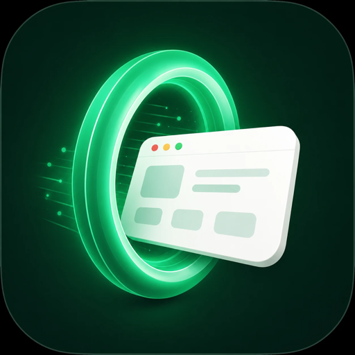
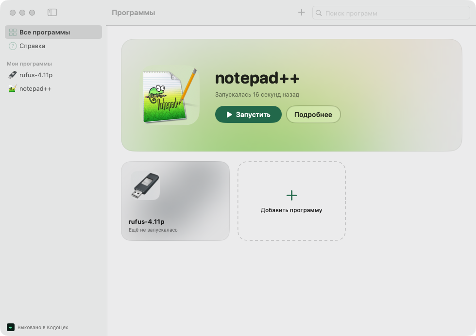
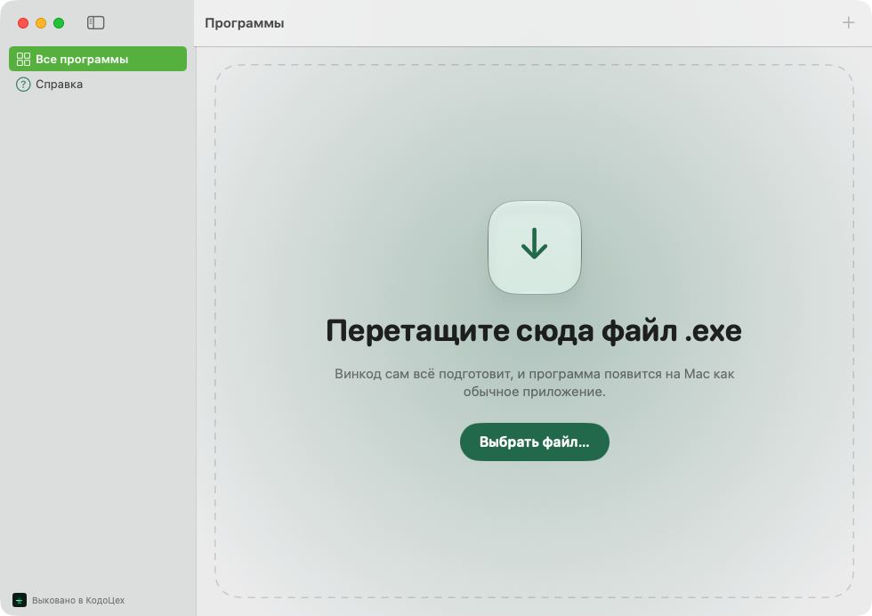
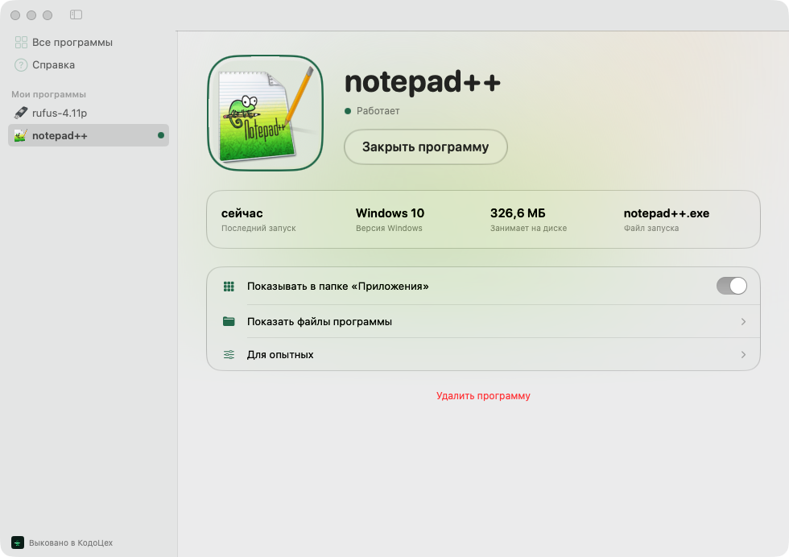
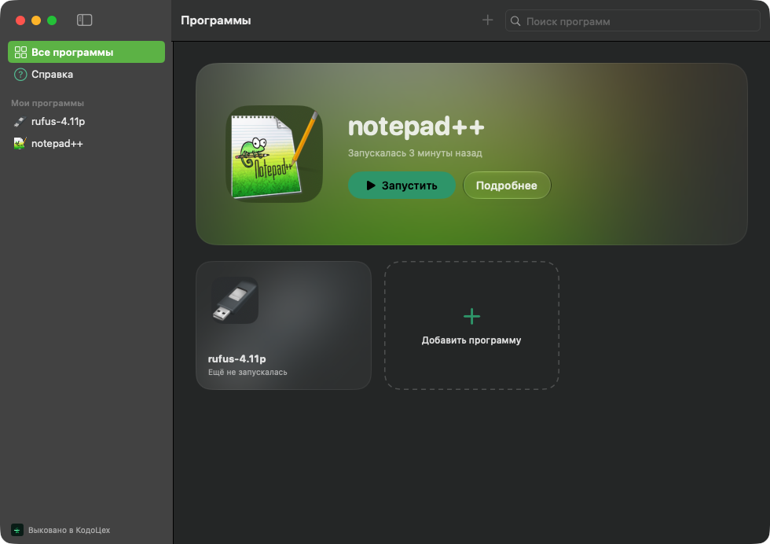
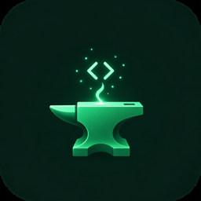

# Винкод

  

**Программы для Windows на Mac: перетащили файл `.exe` и нажали «Запустить».**

Винкод сам готовит среду для программы, достаёт её иконку и может добавить её в папку «Приложения». Настраивать ничего не нужно, Windows ставить тоже.

> **Бета-версия.** Продукт активно развивается. Совместимость с отдельными программами Windows может быть ограничена.

  

## Скачать

| Система | Образ диска | Архив |
|---|---|---|
| macOS 14 и новее, Apple silicon (M1 и новее) | [Winkod-macos-apple.dmg](https://github.com/CodoCeh/Winkod/releases/latest/download/Winkod-macos-apple.dmg) | [Winkod-macos-apple.zip](https://github.com/CodoCeh/Winkod/releases/latest/download/Winkod-macos-apple.zip) |

Ссылки ведут на последнюю версию. Контрольные суммы лежат на странице [релизов](../../releases) в файле `SHA256SUMS.txt`.

## Установка

1. Откройте `Winkod-macos-apple.dmg` и перетащите Винкод в папку «Приложения».
2. Запустите Винкод. macOS сообщит, что не может проверить разработчика: у приложения пока нет платной подписи Apple.
3. Откройте «Системные настройки → Конфиденциальность и безопасность», найдите сообщение о Винкоде и нажмите «Всё равно открыть».
4. Если macOS предложит установить Rosetta, согласитесь. Она нужна для запуска программ Windows.

## Как это работает

Перетащите файл в окно. Первая подготовка программы занимает около минуты, следующие запуски проходят быстрее.

  

На странице программы видно, работает ли она, когда запускалась и сколько занимает на диске. Если программа не запустилась, Винкод показывает причину и кнопку «Исправить», когда умеет решить такую проблему сам.

  

Есть светлая и тёмная тема. По умолчанию Винкод следует за настройкой macOS.

  

## Для опытных

На странице программы есть раздел «Для опытных»:

- выбор файла запуска, версии Windows и графики;
- сочетание клавиш для запуска;
- сохранения в iCloud Drive;
- папки Mac как диски;
- COM-порты для приборов на кабеле;
- запрет доступа к файлам Mac и список разрешённых сайтов;
- перенос программы на другой Mac одним файлом.

Драйверы устройств, профили и запись действий включаются в настройках: «Для опытных → Режим мастерской».

## Что не заработает

- Игры с античитом и программы с защитой на уровне драйвера Windows.
- Программы, которым нужен свой драйвер ядра Windows.
- Не каждая программа Windows запускается на движке Wine. Перед покупкой платной программы проверьте её пробной версией.
- Сейчас движок работает через Rosetta. Apple обещает поддерживать Rosetta для приложений только до macOS 27, поэтому к macOS 28 Винкоду нужен новый движок.

## Обновления

Винкод сам проверяет новую версию на этой странице и показывает кнопку «Обновить». Перед установкой он сверяет контрольную сумму файла. Ваши программы и настройки при этом остаются на месте.

## Исходный код

Код самого Винкода закрыт, условия использования описаны в [LICENSE](LICENSE). Движок собран из открытого кода Wine: исходники приложены к каждому выпуску, а скрипт сборки лежит в [engine](engine). Все компоненты с открытым кодом перечислены в [THIRD-PARTY.md](THIRD-PARTY.md) вместе с лицензиями и ссылками на исходный код.

## Конфиденциальность

Винкод не собирает данные о вас и ваших программах. Подробности в [PRIVACY.md](PRIVACY.md).

## Обратная связь

Сообщить об ошибке можно в разделе [Issues](../../issues). Укажите версию macOS, название программы и что именно произошло.

---

  <a href="https://codoceh.ru"> Выковано в КодоЦех</a>

